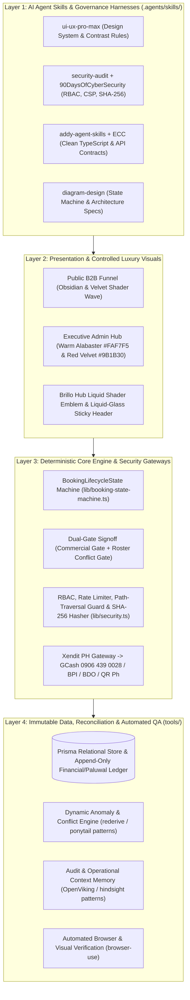
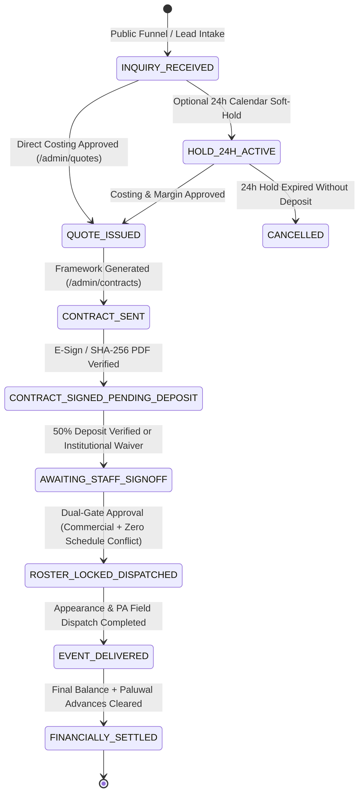

# Brillo Events — Santa Operations Hub (`v3.0` Master Architecture)

## 1. Executive Architectural Overview

The **Brillo Events Santa Operations Hub (`v3.0`)** is a dual-experience enterprise B2B commercial funnel and executive event operations platform engineered on **Next.js 14 (App Router)**, **TypeScript**, **Tailwind CSS**, **Prisma ORM (SQLite / PostgreSQL-ready)**, **Xendit PH Payment Gateway (`xendit-php` + `xendit-node`)**, and a static-resilient snapshot layer for zero-downtime edge delivery on `brilloevent.com`.

### Four-Layer Ecosystem Integration

---

## 2. Deterministic Booking State Machine (`BookingLifecycleState`)

Records follow a strict chronological operational sequence and cannot bypass commercial or roster verification gates:

### Dual-Gate Signoff Invariants (`AWAITING_STAFF_SIGNOFF -> ROSTER_LOCKED_DISPATCHED`)
1. **Gate 1 — Commercial Verification:** Requires an executed contract (`SIGNED` with SHA-256 document digest or Documenso verification) **AND** either verified deposit (`>= 50%` of contract value in `Payment` ledger with `status = VERIFIED`) or an explicit `NO_DP` / `SM_CUSTOM` institutional MOA waiver.
2. **Gate 2 — Operations Roster Verification:** Confirms assigned Santa performer (`TalentAssignment`) has **zero overlapping time blocks** on `eventDate` across all `ROSTER_LOCKED_DISPATCHED` bookings.

---

## 3. Chronological Information Architecture (4 Lifecycle Groups • 9 Core Modules)

| Lifecycle Group | Module | Route | Consolidated Capabilities |
| :--- | :--- | :--- | :--- |
| **COMMAND CENTER** | Executive Overview | `/admin` | 4 chronological priority cards + live Immediate Action Queue & 7-Day Dispatch table |
| **COMMAND CENTER** | Master Calendar & Holds | `/admin/calendar` | Master schedule grid, 24-hour soft-holds, and conflict heatmaps |
| **1. INQUIRIES & COMMERCIAL** | Leads & CRM Pipeline | `/admin/crm` | Unified List + Kanban toggle merging Leads & Inquiries + CRM Pipeline |
| **1. INQUIRIES & COMMERCIAL** | Quotes & Costing | `/admin/quotes` | Direct cost modeling, gross margin preview, and quote issuance prior to booking lock |
| **1. INQUIRIES & COMMERCIAL** | Contracts & E-Sign | `/admin/contracts` | Framework generator + Drag-and-Drop PDF/Image upload with SHA-256 verification |
| **2. OPERATIONS & DISPATCH** | Bookings & Signoff | `/admin/bookings` | Unified `[All]`, `[Package Events]`, `[Direct Talent]`, and `[Awaiting Signoff]` with Dual-Gate approval |
| **2. OPERATIONS & DISPATCH** | Santa & Crew Roster | `/admin/roster` | Unified 14 Real-Beard Santa Performers + PA & Field Support Crew |
| **2. OPERATIONS & DISPATCH** | Clients & Agencies | `/admin/clients` | Corporate accounts, mall groups (SM, Ayala, Megaworld), and agency partners |
| **3. FINANCE & SETTLEMENT** | Payments & Receivables | `/admin/payments` | Xendit PH automatic gateway (`0906 439 0028` GCash / BPI / BDO) + deposit verification |
| **3. FINANCE & SETTLEMENT** | Expenses & Paluwal Ledger | `/admin/expenses` | Unified append-only Event Expenses + Talent Advances (`Paluwal`) immutable ledger |

---

## 4. Security, RBAC & Compliance Controls

1. **Role-Based Access Control (`lib/security.ts`):**
   - `SUPER_ADMIN`: Full commercial, operational, financial, and governance mutations.
   - `OPS_ADMIN`: Inquiries, quotes, contracts, roster dispatch, and conflict resolution.
   - `FINANCE_ADMIN`: Payment verification, Xendit settlement config, expenses, and Paluwal ledger.
   - `VIEWER`: Read-only access to dashboards, calendars, and reports.
2. **Document Upload & URL Validation:**
   - Rejects raw local path traversal (`../`, `\\`, drive letters, unverified filesystem paths).
   - Accepts drag-and-drop PDF/PNG/JPG uploads hashed client- & server-side with **SHA-256** (`sha256:<64-hex>`) or allowlisted HTTPS object storage URLs.
3. **Immutable Financial & Paluwal Ledger:**
   - Revenue, receivables, and Paluwal balances derive from append-only `Payment`, `Expense`, and `TalentLedgerEntry` records with `AuditLog` provenance.
4. **HTTP Security Headers (`next.config.mjs`):**
   - Strict `Content-Security-Policy`, `X-Content-Type-Options: nosniff`, `X-Frame-Options: SAMEORIGIN`, and `Referrer-Policy: strict-origin-when-cross-origin`.
