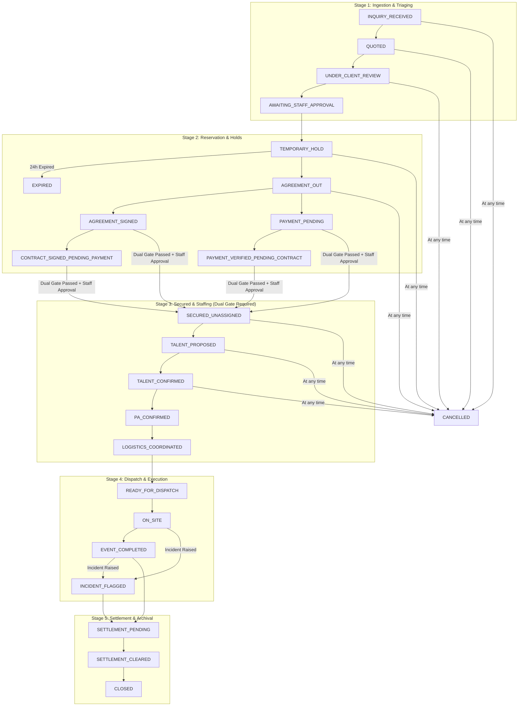

# Santa Operations Hub - 22-State Booking Lifecycle Specification

## 1. Lifecycle Architecture & Operational Stages

The booking state machine governs all Santa and performer engagements, preventing double-bookings, unauthorized confirmations, and premature talent disbursements.

The system partitions the 22 states into **5 sequential operational stages**:

---

## 2. The 22 Booking States

| # | State Name | Operational Stage | Description | Permitted Roles |
| :--- | :--- | :--- | :--- | :--- |
| 1 | `INQUIRY_RECEIVED` | Stage 1: Ingestion | Booking inquiry captured from public funnel, email, or import. | System, Sales |
| 2 | `QUOTED` | Stage 1: Ingestion | Pricing quote calculated and sent to client. | Sales, Admin |
| 3 | `UNDER_CLIENT_REVIEW` | Stage 1: Ingestion | Client reviewing options or dates. | Sales, Client |
| 4 | `AWAITING_STAFF_APPROVAL` | Stage 1: Ingestion | Custom requirements/holiday rate waiting for staff signoff. | Sales, Ops, Admin |
| 5 | `TEMPORARY_HOLD` | Stage 2: Reservation | 24-hour calendar hold placed on date/venue. | Sales, Ops, Admin |
| 6 | `EXPIRED` | Stage 2: Reservation | Hold window lapsed without deposit confirmation. | System Cron, Ops |
| 7 | `AGREEMENT_OUT` | Stage 2: Reservation | Service contract drafted and dispatched for e-signature. | Sales, Admin |
| 8 | `AGREEMENT_SIGNED` | Stage 2: Reservation | Client completed digital signature; awaiting payment verification. | Client, System |
| 9 | `PAYMENT_PENDING` | Stage 2: Reservation | Client submitted deposit proof; awaiting finance verification. | Client, Finance |
| 10 | `PAYMENT_VERIFIED_PENDING_CONTRACT` | Stage 2: Reservation | Deposit verified in bank, but e-contract remains unsigned. | Finance, Ops |
| 11 | `CONTRACT_SIGNED_PENDING_PAYMENT` | Stage 2: Reservation | Contract executed, but deposit has not yet cleared. | Sales, Finance |
| 12 | `SECURED_UNASSIGNED` | Stage 3: Secured | **Dual-Gate Cleared**: Both contract & deposit verified. Roster ready. | Ops, Admin |
| 13 | `TALENT_PROPOSED` | Stage 3: Secured | Candidate Santa selected based on venue, beard, and costume tiers. | Ops, Admin |
| 14 | `TALENT_CONFIRMED` | Stage 3: Secured | Talent accepted date/call time without calendar collision. | Ops, Admin |
| 15 | `PA_CONFIRMED` | Stage 3: Secured | Production Assistant / Santa Handler assigned to gig. | Ops, Admin |
| 16 | `LOGISTICS_COORDINATED` | Stage 3: Secured | Dressing room, parking, snacks, costume staging verified. | Ops, Admin |
| 17 | `READY_FOR_DISPATCH` | Stage 4: Execution | 24-hour pre-event call completed; talent in transit. | Ops, Admin |
| 18 | `ON_SITE` | Stage 4: Execution | Performer clocked in at venue with PA. | Ops, PA, Admin |
| 19 | `EVENT_COMPLETED` | Stage 4: Execution | Performance concluded; client sign-off received. | Ops, PA, Admin |
| 20 | `INCIDENT_FLAGGED` | Stage 4: Execution | Wardrobe malfunction, delay, client complaint, or health issue. | Ops, Admin |
| 21 | `SETTLEMENT_PENDING` | Stage 5: Settlement | Awaiting final balance payment, Paluwal reconciliation, and payout. | Finance, Admin |
| 22 | `SETTLEMENT_CLEARED` | Stage 5: Settlement | Balance settled, talent paid, net margin locked. | Finance, Admin |
| -- | `CLOSED` | Stage 5: Archival | Post-event records archived. | Admin |
| -- | `CANCELLED` | Terminal | Booking cancelled by client or internal decision. | Sales, Ops, Admin |

---

## 3. Strict Dual-Gate Security Invariant

> [!IMPORTANT]
> **No booking may transition to `SECURED_UNASSIGNED` without satisfying the Dual Gate.**
>
> In `lib/booking-state.ts`:
> 1. `hasSignedAgreement === true`: Legally executed contract or verified historical contract.
> 2. `hasVerifiedPayment === true`: Finance-verified reservation deposit in bank records.
> 3. `isStaff === true`: Only authorized staff (`ADMIN` or `OPS`) can trigger this promotion. Uploading a proof image from a public form does **not** grant secured status.

---

## 4. 24-Hour Temporary Hold Expiration Engine

1. When a client places a temporary hold on a date or performer, `holdExpiresAt` is stamped with $\text{now} + 24\text{ hours}$.
2. The `/api/cron/release-holds` endpoint checks for all bookings where:
   - `status = 'TEMPORARY_HOLD'`
   - `holdExpiresAt < NOW()`
   - `isHoldExpired = false`
3. Expired holds transition to `EXPIRED`, release calendar holds, and log an audit trail entry with actor `SYSTEM_HOLD_WATCHER`.
